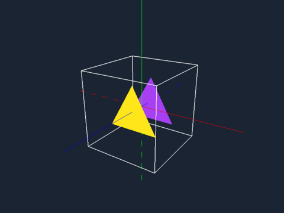
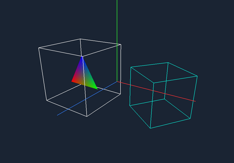
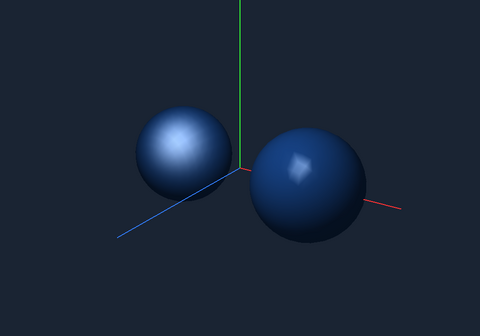
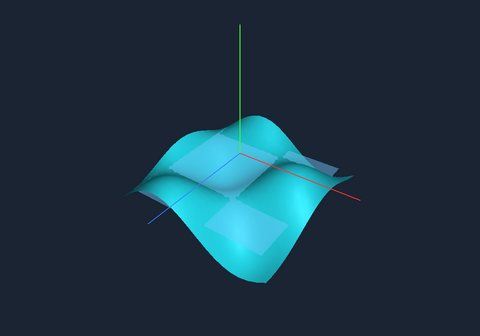
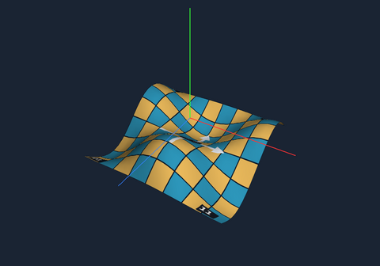
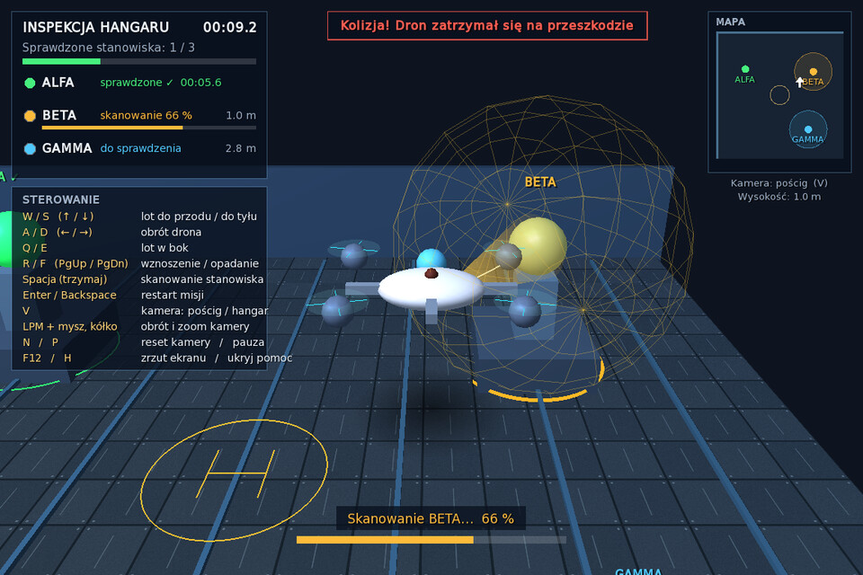
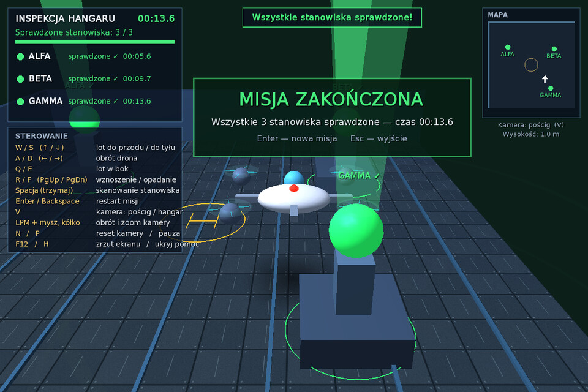
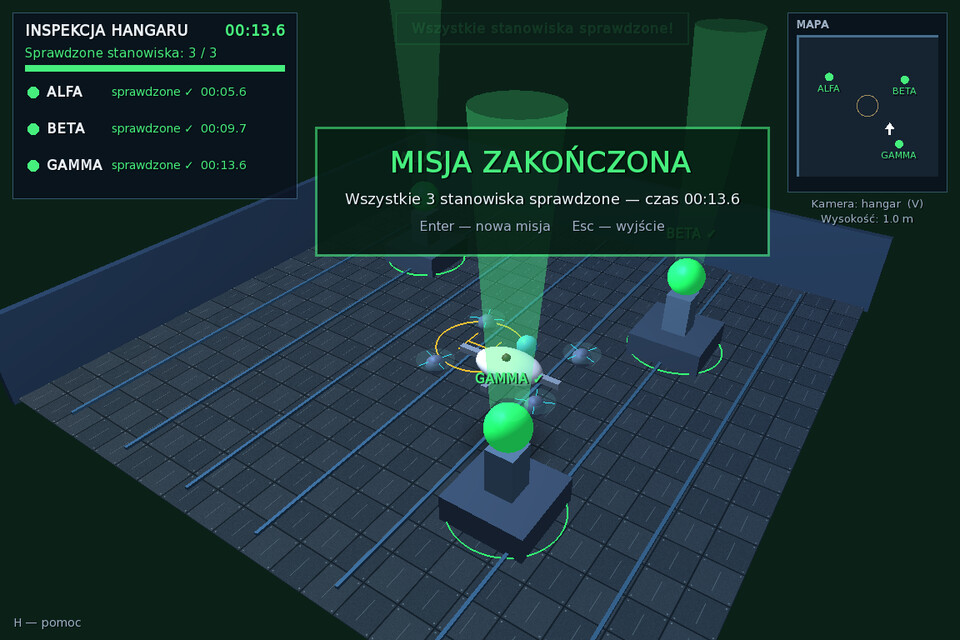

# Grafika 3D — OpenGL + SFML (AGH)

Rozwiązania laboratoriów 1–5 (zadania 1–20) i mini-projektu 1 z przedmiotu **Grafika 3D**, plus
**g3d** — mała biblioteka nagłówkowa z mechanizmami, które powtarzają się na kolejnych zajęciach
(kamera orbitalna, projekcja, oświetlenie, siatki z normalnymi, tekstury, shadery, kolizje AABB, HUD,
zrzut ekranu) oraz **szablon** startowy na następne laby.

**Środowisko:** C++11 lub nowszy · SFML 2.5.1 · klasyczny OpenGL 2.1 (fixed-function) + GLU · GLSL 1.20 ·
Visual Studio 2022 (x64, NuGet) albo CMake (Windows / Linux).

| Lab 1 | Lab 2 | Lab 3 | Lab 4 | Lab 5 |
|---|---|---|---|---|
|  |  |  |  |  |

| Mini-projekt 1: skanowanie | misja zakończona | widok hangaru |
|---|---|---|
|  |  |  |

## Zawartość

| Folder | Co jest w środku |
|---|---|
| [`lab01/`](lab01/main.cpp) | Lab 1 — okno OpenGL, kamera, osie, trójkąt, szkielet sześcianu, bufor głębi (zad. 1–4) |
| [`lab02/`](lab02/main.cpp) | Lab 2 — transformacje T·R·S, dwa obiekty, kamera orbitalna, perspektywa / orto (zad. 5–8) |
| [`lab03/`](lab03/main.cpp) | Lab 3 — bryły GLU, światło, ruchome źródło, materiały i połysk (zad. 9–12) |
| [`lab04/`](lab04/main.cpp) | Lab 4 — własna siatka 21×21, normalne flat/smooth, animacja, mysz, przezroczystość (zad. 13–16) |
| [`lab05/`](lab05/main.cpp) | Lab 5 — tekstury i UV, powtarzanie i filtrowanie, shadery GLSL, fala na GPU (zad. 17–20) + [`ODPOWIEDZI.md`](lab05/ODPOWIEDZI.md) |
| [`miniprojekt1/`](miniprojekt1/) | Mini-projekt 1 — dron inspekcyjny w hangarze 3D + [`OPIS.md`](miniprojekt1/OPIS.md) |
| [`szablon/`](szablon/main.cpp) | Punkt startowy na kolejne laby: okno, kamera, projekcja, światło, siatka, zrzut ekranu |
| [`g3d/`](g3d/g3d.hpp) | Biblioteka nagłówkowa z mechanizmami z labów (opis niżej) |
| [`vs/Grafika3D.props`](vs/Grafika3D.props) | Arkusz właściwości Visual Studio — cała konfiguracja projektu jednym kliknięciem |
| `CMakeLists.txt` | Budowanie wszystkiego naraz (SFML z systemu albo pobierany automatycznie) |

Każdy lab to **jeden plik `main.cpp`**, w którym wszystkie zadania danego laboratorium działają naraz —
klawisze `F1`–`F4` (w lab 1: `1`–`4`) przełączają stan „po zadaniu N". Dzięki temu można pokazać
prowadzącemu każde zadanie osobno, a plik da się wkleić do pustego projektu VS bez żadnych zależności.
Klawisze są opisane w nagłówku każdego pliku i w tytule okna.

## Uruchomienie

### Visual Studio 2022 (jak na zajęciach)

1. **Console App (C++)**, platforma **x64**. NuGet: `Install-Package sfml_graphics -Version 2.5.1`.
2. Skopiuj do katalogu projektu `main.cpp` wybranego laba (dla lab 5 także `assets/` i `shaders/`).
3. *View → Other Windows → Property Manager →* prawy klik na projekt *→ Add Existing Property Sheet…*
   *→* [`vs/Grafika3D.props`](vs/Grafika3D.props). Arkusz ustawia: `opengl32.lib; glu32.lib`, biblioteki
   SFML z folderu `packages` (naprawia `LNK2019 sf::...` w nowym VS), kopiowanie DLL-i obok `.exe`,
   brak PCH, C++17, `/utf-8`, `NOMINMAX`, SubSystem Console i *Working Directory* = `$(ProjectDir)`.
4. `F5`.

**Mini-projekt / szablon:** dodaj do projektu wszystkie pliki `.cpp` z folderu i skopiuj folder `g3d/`
obok nich (albo dodaj katalog repozytorium w *C/C++ → Additional Include Directories*) oraz `assets/`.

> Projekty **wxWidgets** (IUiBG) potrzebują *Linker → System → SubSystem = Windows* — nie dodawaj do
> nich tego arkusza (ustawia Console, co daje `LNK2019: unresolved external symbol main`).

### CMake (Windows / Linux)

```bash
# Linux: sudo apt install g++ cmake libsfml-dev
cmake -S . -B build -DCMAKE_BUILD_TYPE=Release
cmake --build build -j
cd build/bin/lab05 && ./lab05          # każdy program ma własny katalog z assets/ i shaders/
```

Jeśli SFML nie ma w systemie, CMake pobierze SFML 2.6.2 (API zgodne z 2.5.1). W Visual Studio wystarczy
*File → Open → Folder…* na repozytorium — bez NuGeta. Kod jest sprawdzany z `-std=c++11 -Wall -Wextra
-Wpedantic -Wconversion` bez ostrzeżeń.

## Laboratoria — co gdzie jest

### Lab 1 — podstawy (`1`–`4`, start: zadanie 4)

| Zad. | Rozwiązanie | Funkcje |
|---|---|---|
| 1 | okno 800×600, kontekst OpenGL 2.1 z buforem głębi 24 bit, pętla zdarzeń, kolor tła | `main`, `initOpenGL` |
| 2 | `gluPerspective` + `gluLookAt`, osie XYZ; `N` — ujemne półosie linią przerywaną, `C` — inne położenia kamery | `resizeProjection`, `setCamera`, `drawAxes` |
| 3 | trójkąt z interpolacją kolorów i szkielet sześcianu (`GL_LINES`) | `drawTriangle`, `drawWireCube` |
| 4 | dwa trójkąty w różnej głębokości; `D` — test głębokości wł./wył. | `drawDepthTriangles` |

### Lab 2 — transformacje i kamera (`F1`–`F4`, start: zadanie 8)

| Zad. | Rozwiązanie | Klawisze |
|---|---|---|
| 5 | obiekt (trójkąt + sześcian) z T·R·S, ruch zależny od `deltaTime` | strzałki, `J`/`L`, `I`/`K`, `R` |
| 6 | drugi, niezależny obiekt (`glPushMatrix`/`glPopMatrix`); eksperyment kolejności R·T | `X`, `Z`, `Y` (auto-obrót) |
| 7 | kamera orbitalna we współrzędnych sferycznych, ograniczenie elewacji i promienia | `F`/`H`, `T`/`G`, `O`/`P`, `N`, kółko |
| 8 | perspektywa ↔ rzut ortograficzny z zachowaniem proporcji okna, zmiana fov | `9`/`0`, `V`/`B` |

### Lab 3 — bryły GLU i oświetlenie (`F1`–`F4`, start: zadanie 12)

| Zad. | Rozwiązanie | Klawisze |
|---|---|---|
| 9 | sfera, walec (z denkami `gluDisk`) i stożek z jednej kwadryki GLU | `U`, `L`, `I` |
| 10 | `GL_LIGHT0`, `GL_COLOR_MATERIAL`, normalne kwadryki smooth / none | `M`, `C` |
| 11 | ruchome światło punktowe (1.5 j/s) z markerem, tłumienie, światło kierunkowe | `A`/`D`, `S`/`W`, `Q`/`E`, `Spacja`, `Y` |
| 12 | dwie sfery z jawnym materiałem: połysk 8 vs regulowany, składowa zwierciadlana | `Z`/`X`, `K` |

### Lab 4 — siatki, normalne, animacja (`F1`–`F4`, start: zadanie 16)

| Zad. | Rozwiązanie | Klawisze |
|---|---|---|
| 13 | siatka 21×21 (441 wierzchołków, 800 trójkątów CCW), szachownica, dane oddzielone od rysowania | `L` |
| 14 | fala `y = -0.35 + 0.3 sin(πx) cos(πz)`, `cross`/`normalize`, normalne flat ↔ smooth, wizualizacja normalnych | `C`, `K`, `M` |
| 15 | fala z fazą (`1.5·dt`), przeliczanie pozycji i normalnych co klatkę, kamera myszą | `Spacja`, `Z`/`X`, `R`, LPM, kółko |
| 16 | przezroczysta warstwa: `GL_BLEND` + `glDepthMask(GL_FALSE)`; eksperyment bez testu głębokości; zrzut `F12` | `Y`, `A`/`D`, `U`, `F12` |

### Lab 5 — tekstury i GLSL (`F1`–`F4`, start: zadanie 20)

| Zad. | Rozwiązanie | Klawisze |
|---|---|---|
| 17 | `uv_grid.png` na siatce, UV liczone raz przy tworzeniu siatki, obsługa błędu wczytania | `Spacja` |
| 18 | `stone.png`, `setRepeated`, 1× ↔ 4× przez skalowanie UV, filtrowanie nearest ↔ linear dla obu tekstur; rozszerzenie: 1/2/4/8× | `T`, `R`, `E`, `F` |
| 19 | [`surface.frag`](lab05/shaders/surface.frag): szarość (0.299/0.587/0.114) i pulsowanie `0.8 + 0.2 sin(2.5t)` | `H`, `G`, `P` |
| 20 | [`wave.vert`](lab05/shaders/wave.vert): wysokość, normalna `(-dh/dx, 1, -dh/dz)` i Lambert w przestrzeni kamery; CPU ↔ GPU bez skoku fazy; rozszerzenie: częstotliwość | `C`, `U`/`I`, `Z`/`X` |

Kamera w lab 5: mysz albo strzałki / `PgUp` / `PgDn` (litery są zajęte przez zadania), reset fali: `Backspace`.
Odpowiedzi na pytania z zadania 20 (i różnica `glDepthMask` vs `glDisable(GL_DEPTH_TEST)` z zadania 16):
[`lab05/ODPOWIEDZI.md`](lab05/ODPOWIEDZI.md).

### Mini-projekt 1 — dron inspekcyjny

Sterowanie dronem z bezwładnością, kolizje AABB ze „ślizganiem", inspekcja trzech stanowisk (strefa +
przytrzymanie `Spacji`, bez podwójnego zaliczenia), HUD (panel, minimapa, kompas, podpisy 3D, komunikaty,
plansza końcowa), efekty (promień skanera, fala, cień, pochylanie drona, słupy światła), restart `Enter`,
dwie kamery `V`, pauza `P`. Szczegóły i scenariusz testowy: [`miniprojekt1/OPIS.md`](miniprojekt1/OPIS.md).

## g3d — mechanizmy do ponownego użycia

`#include "g3d/g3d.hpp"` (albo pojedyncze nagłówki). Wszystko jest `inline` — wystarczy skopiować folder.

| Nagłówek | Co daje | Skąd (lab / zadanie) |
|---|---|---|
| [`math.hpp`](g3d/math.hpp) | `Vec3`, `dot`, `cross`, `normalize`, `clampf`, `lerp`, `smoothTowards` (wygładzanie niezależne od FPS), `angleDelta` | lab 4 / zad. 14, mini-projekt |
| [`timer.hpp`](g3d/timer.hpp) | `FrameTimer` — `deltaTime` z ograniczeniem 0.05 s | lab 2 / zad. 5 |
| [`camera.hpp`](g3d/camera.hpp) | `OrbitCamera` — sferyczna, klawisze (`OrbitKeys`) + mysz, limity, `forwardXZ`/`rightXZ` | lab 2 / zad. 7, lab 4 / zad. 15 |
| [`projection.hpp`](g3d/projection.hpp) | `Projection` — perspektywa/orto, fov, `Resized` | lab 2 / zad. 8 |
| [`draw.hpp`](g3d/draw.hpp) | osie (z przerywanymi półosiami), szkielet sześcianu, `drawBox` z normalnymi, okręgi/łuki i pierścienie na podłodze | lab 1, mini-projekt |
| [`gl_state.hpp`](g3d/gl_state.hpp) | RAII: `ScopedMatrix`, `ScopedCapability`, `ScopedLineWidth`, `ScopedPointSize`, `ScopedTransparency` | lab 2, lab 4 / zad. 16 |
| [`lighting.hpp`](g3d/lighting.hpp) | `setupLight`, `setLightPosition` (punktowe / kierunkowe), tłumienie, `setMaterial`, `useColorMaterial` | lab 3 / zad. 10–12 |
| [`mesh.hpp`](g3d/mesh.hpp) | `GridMesh` — siatka N×N z dowolną funkcją wysokości, normalne flat/smooth, UV, wizualizacja normalnych | lab 4 / zad. 13–15, lab 5 / zad. 17 |
| [`texture.hpp`](g3d/texture.hpp) | `loadTexture` (repeat, smooth, komunikat o złym katalogu roboczym), `ScopedTexture` | lab 5 / zad. 17–18 |
| [`shader.hpp`](g3d/shader.hpp) | `loadShader` (z `isAvailable`), `ScopedShader` | lab 5 / zad. 19–20 |
| [`collision.hpp`](g3d/collision.hpp) | `Aabb`, `penetration`, `slideMove` — ruch oś po osi z blokowaniem tylko kolizyjnej osi | mini-projekt |
| [`hud.hpp`](g3d/hud.hpp) | `Hud` — tekst (polskie znaki), panele, paski postępu, kółka, strzałki na scenie OpenGL | mini-projekt |
| [`screenshot.hpp`](g3d/screenshot.hpp) | `saveScreenshot` — `glReadPixels` z tylnego bufora + odwrócenie w pionie | lab 4 / rozszerzenie zad. 16 |

Przykład (pełna wersja w [`szablon/main.cpp`](szablon/main.cpp)):

```cpp
#include "g3d/g3d.hpp"

g3d::OrbitCamera camera(4.0f, 0.6f, 0.45f);
g3d::Projection projection;
g3d::GridMesh surface(21, 1.0f);
// ...
camera.handleEvent(event);                       // LPM + mysz, kółko
if (projection.handleKey(key)) projection.apply(w, h);
camera.updateKeys(dt);                           // F/H T/G O/P
surface.build([&](float x, float z) { return 0.3f * std::sin(g3d::PI * x - phase); });

camera.apply();                                  // 1) kamera
g3d::setLightPosition(GL_LIGHT0, {1.5f, 2.2f, 1.3f});   // 2) światło po kamerze
g3d::drawAxes();
{ g3d::ScopedCapability lit(GL_LIGHTING, true); surface.draw(true); }
{ g3d::ScopedTransparency glass; /* półprzezroczyste obiekty na końcu */ }
```

## Ściąga — rzeczy, które łatwo zepsuć

- **Kolejność w klatce:** `glClear` → kamera (`gluLookAt`) → `glLightfv(GL_POSITION)` → obiekty
  nieprzezroczyste → przezroczyste (`GL_BLEND`, `glDepthMask(GL_FALSE)`) → HUD → `display()`.
- **T·R·S:** w kodzie `glTranslatef` → `glRotatef` → `glScalef`, a na obiekt działa to w odwrotnej
  kolejności (skalowanie, obrót, przesunięcie); każdy obiekt w `glPushMatrix`/`glPopMatrix`.
- **`deltaTime`** z `sf::Clock::restart()` przycięty do 0.05 s; ruch = prędkość × `dt`.
- **Normalne** po deformacji trzeba przeliczyć (albo liczyć w shaderze); `GL_NORMALIZE` po `glScalef`.
- **Ścieżki `assets/`, `shaders/`** są względne do *katalogu roboczego* (VS: `$(ProjectDir)`).
- **HUD SFML na scenie OpenGL:** `window.pushGLStates()` … `window.popGLStates()`.
- **Polskie znaki:** literały `L"..."`, pliki UTF-8 (z BOM albo `/utf-8` w MSVC).
- **`std::min`/`std::max` w MSVC:** `SFML/OpenGL.hpp` dołącza `windows.h` z makrami `min`/`max` —
  `NOMINMAX` musi być zdefiniowane przed includami (pliki labów i `g3d/gl.hpp` robią to same).
- **SFML 2.5.1:** `sf::Keyboard::BackSpace` (w 2.6 też działa), `setUniform(..., sf::Shader::CurrentTexture)`.

## Uwagi

Tekstury z lab 5, szkielety shaderów i scena startowa mini-projektu pochodzą z materiałów prowadzącego,
dlatego repozytorium powinno być **prywatne**. Czcionka DejaVu Sans: licencja w
[`miniprojekt1/assets/fonts/LICENSE-DejaVu.txt`](miniprojekt1/assets/fonts/LICENSE-DejaVu.txt).
